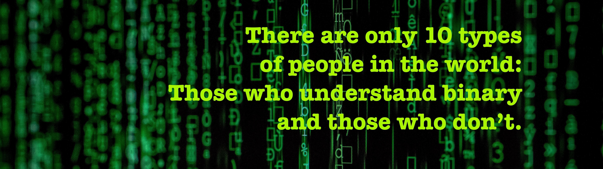
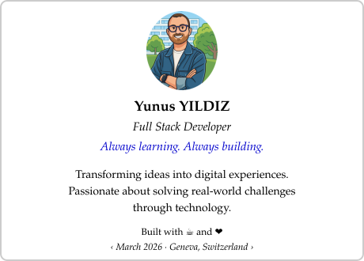

<h1 align="center"> Hi 👋, I'm Yunus YILDIZ </h1>
<h3 align="center"> A Passionate Full-Stack Developer from Switzerland</h3>

---

  

  

  

    
    
    
    
     
    
    
    
    
    
  

  

  
  

---

### 📊 GitHub Stats

  

    
  

---

### 🧰 Tech Stack  
> Tools, languages, and frameworks I use regularly  

<!-- 🧠 Skill Icons -->
 
<!-- 🏷️ Badges -->

---

  
Yunus YILDIZ ★ 2025 

  
📍Geneva

